# CarSharingApplication
### Приложение Каршеринга
# База данных
### MSSQL SERVER 2019
# Инструкция пользователю
  ## 1. Создание базы данных
  ### 1.1. Выполните скрипт на создание базы данных
  ### 1.2. Выполните скрипт на заполнение базы данных
  ## 2. Подключение к базе данных
  ### 2.1. Измените строки подключения в файле .config на имя вашего сервера 
  #### P.S. Убедитесь что он настроен на удалённое подключение в SSMS
  ## 3. Настройка автоматического резервного копирования базы данных
  ### 3.1. Зайдите в планировщик заданий Windows
  ### 3.2. Создайте простую задачу
  #### 3.2.1. Выберите время выполнения задачи и частоту
  #### 3.2.2. Выберите действие "Запустить программу"
  #### 3.2.3. Выберите путь к файлу проекта MakeBackUp.bat
  #### 3.2.4. Добавьте аргумент (путь куда будет сохранятся резервная копия)
# Возможности ипользования
  ### Аутентификация пользователя
  ### Регистрация пользователя
  ### Авторизация пользователя
  ### Внесение дополнительных данных пользователя
  ### Выбор ТС
  ### Аренда ТС
# Модерация БД
  ### Возможность просмотра, изменения, удаления записей в таблице Пользователи
  ### Возможность просмотра, изменения, удаления записей в таблице Водительские Удостоверения
  ### Возможность просмотра, изменения, удаления записей в таблице Категории Водительских Удостоверений
  ### Возможность просмотра, изменения, удаления записей в таблице Транспортные Средства
  ### Возможность просмотра, изменения, удаления записей в таблице Координаты Транспортных Средств
  ### Возможность просмотра, изменения, удаления записей в таблице Свидетельства о регистрации транспортных средств
  ### Возможность просмотра, изменения, удаления записей в таблице Классы Транспортных Средств
  ### Возможность просмотра, изменения, удаления записей в таблице Аренда Транспортных Средств
  ### Возможность просмотра, изменения, удаления записей в таблице Типы ДТП
  ### Возможность просмотра, изменения, удаления записей в таблице ДТП
  ### Возможность просмотра предстваления Подробная информация о пользователях
  ### Возможность просмотра предстваления Подробная информация о действующих категориях водительских удостоверений
  ### Возможность просмотра предстваления Подробная информация о Транпортных Средствах
  ### Возможность просмотра предстваления Подробная информация о Арендах
# Функции владельца Базы данных
  ### Назначение администраторов
  ### Просмотр таблицы Журнала действий

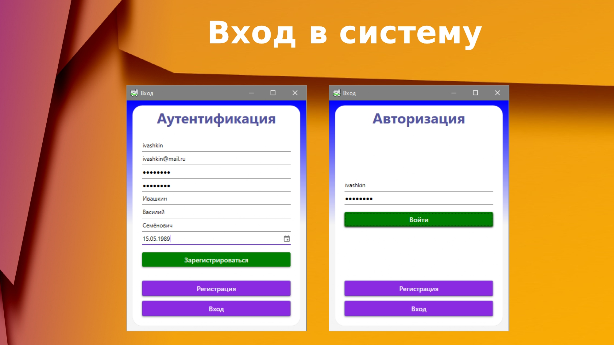
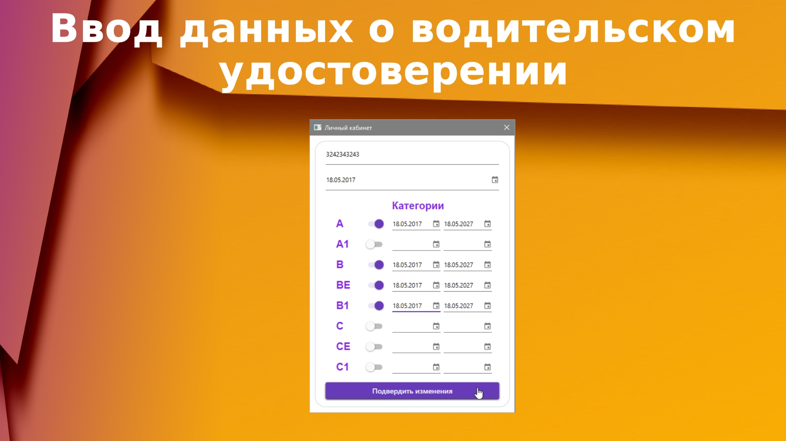
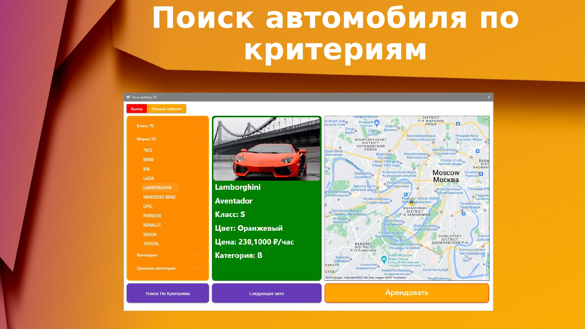
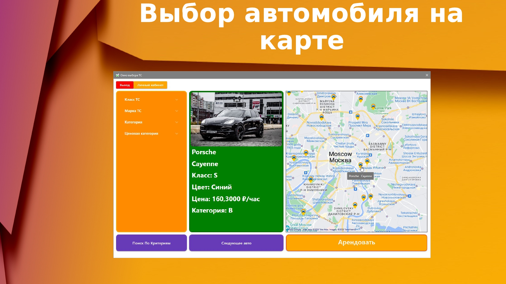
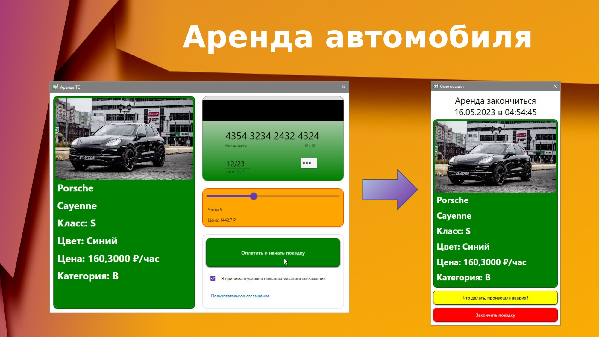

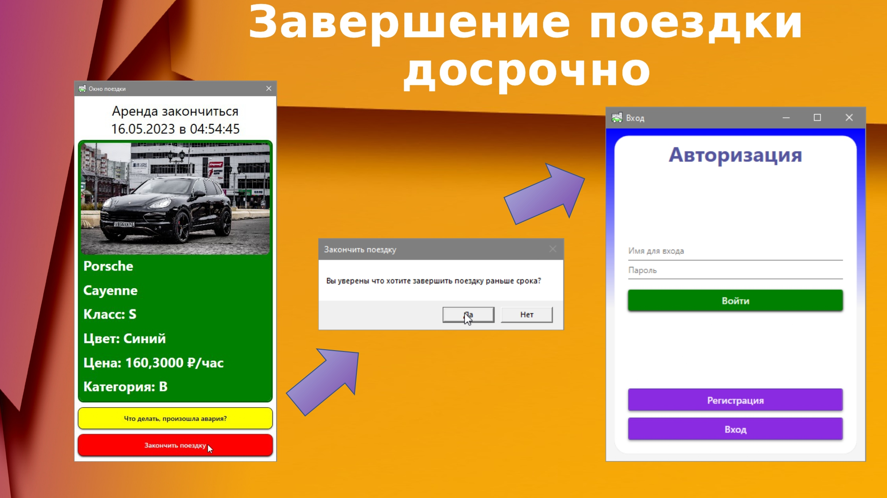
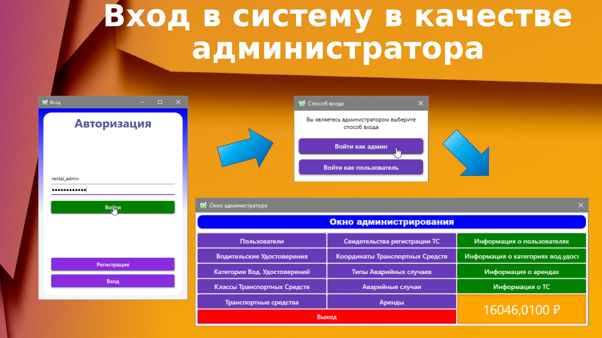
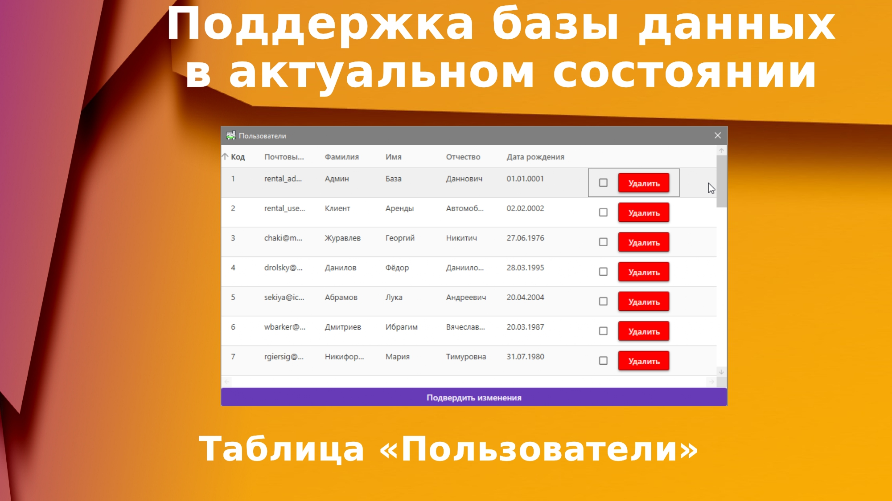
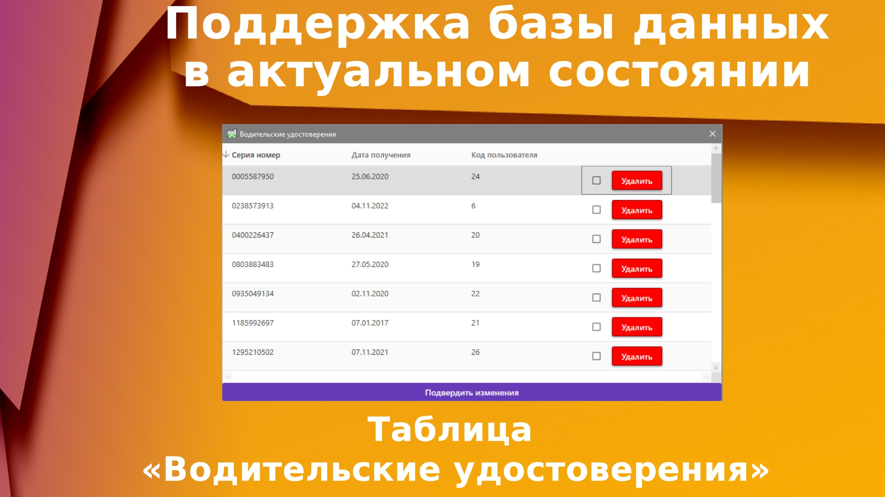

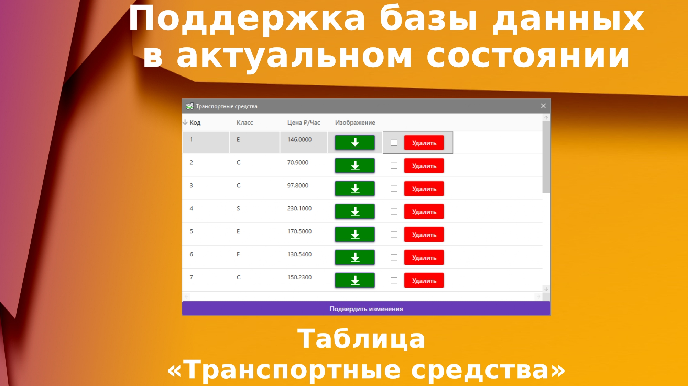
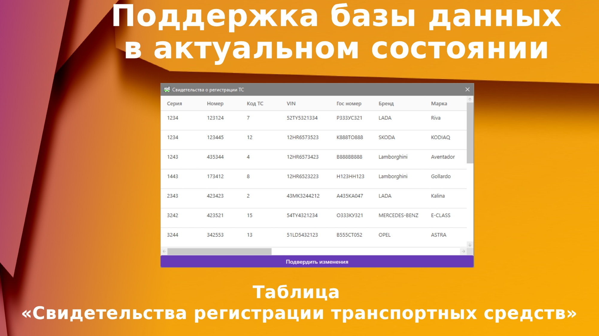
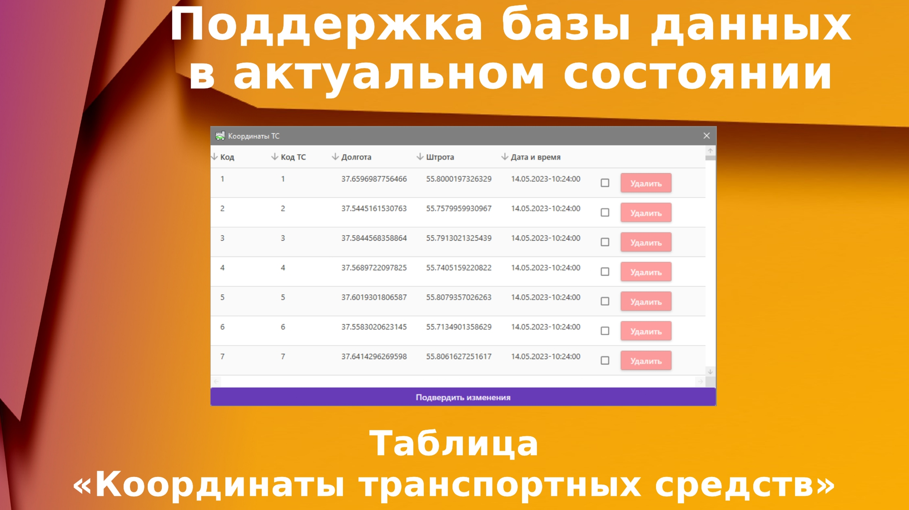

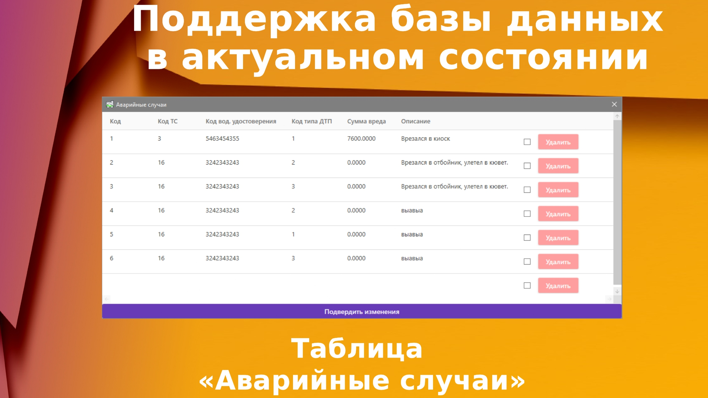
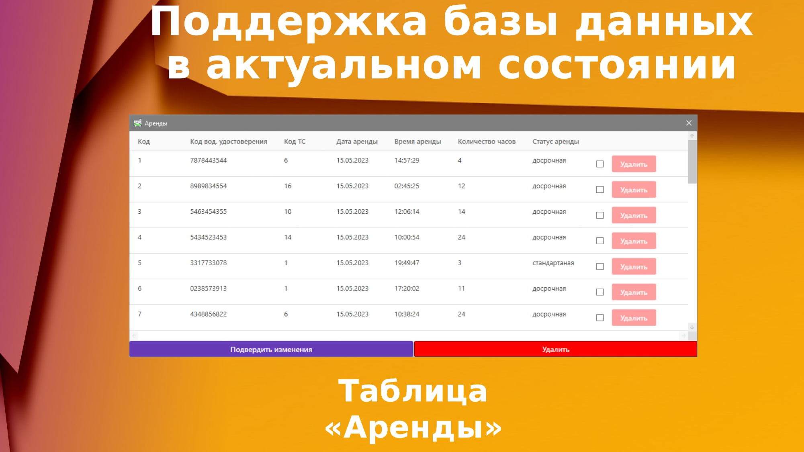
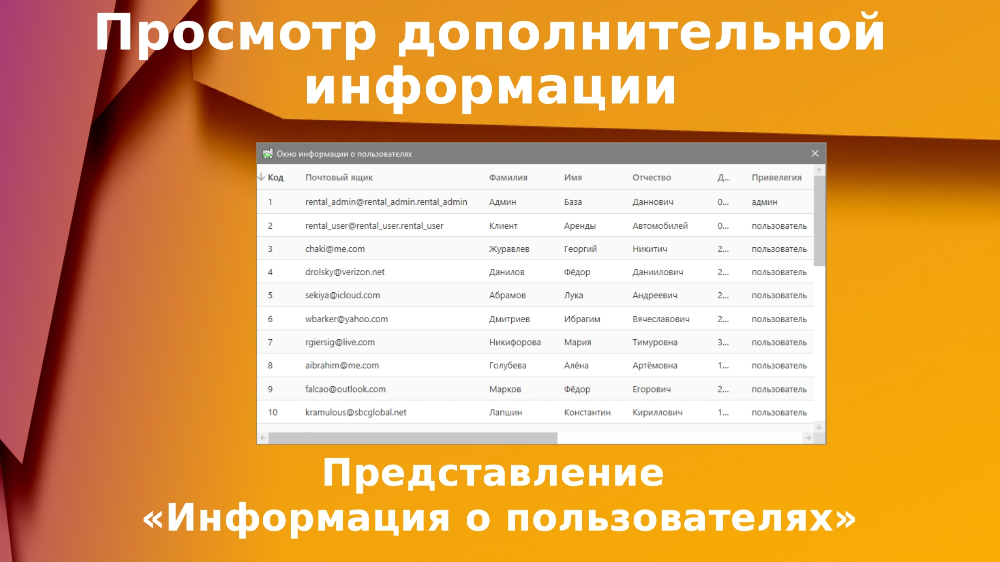
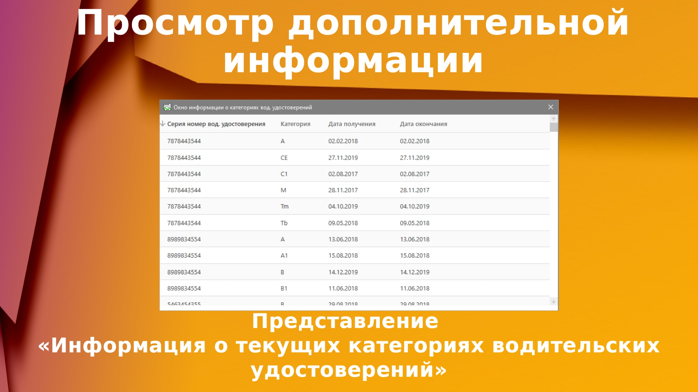
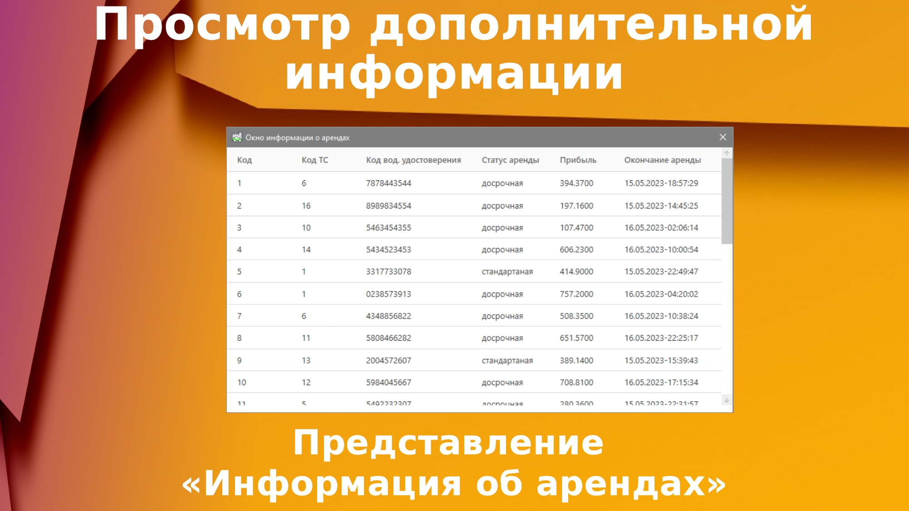
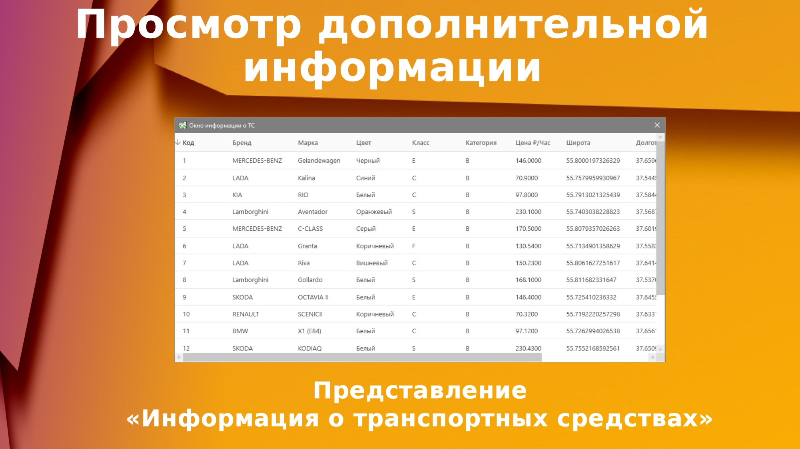
